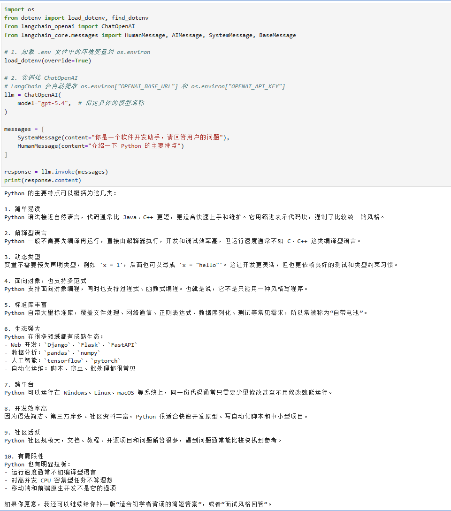

# 第一章、LangChain开发环境搭建

# 1、环境信息

| 操作系统 | Ubuntu 26.04 |
| --- | --- |
| Python版本 | 3.14+ |
| LangChain版本 | 1.2.x |
| MiniConda | 最新版本 |

# 2、安装miniconda3及创建虚拟环境

```bash
# 2.1 下载 miniconda3 安装脚本
sudo apt update && sudo apt install -y wget curl
mkdir -p ~/miniconda3
wget https://repo.anaconda.com/miniconda/Miniconda3-latest-Linux-x86_64.sh -O ~/miniconda3/miniconda.sh

# 2.2 安装miniconda3
bash ~/miniconda3/miniconda.sh -b -u -p ~/miniconda3    # -b 表示自动模式，-u 表示覆盖更新，-p 指定安装路径
rm ~/miniconda3/miniconda.sh

# 2.3 初始化 Shell 环境
~/miniconda3/bin/conda init bash

# 2.4 刷新配置并验证
source ~/.bashrc
$ conda --version
conda 26.7.1

# 若不希望终端在启动时默认激活 (base) 虚拟环境，可以关闭自动激活功能：
conda config --set auto_activate_base false

# 2.5 创建LangChain虚拟环境
conda create --name langchain1.x python=3.14.7

# 2.6 初始化虚拟环境
conda init

# 2.7 激活LangChain虚拟环境
conda activate langchain1.x

# 2.8 退出虚拟环境
conda deactivate

# 2.9 删除虚拟环境
conda remove --name langchain1.x --all

```

# 3、安装LangChain包及必要依赖包

```bash
# 注意：执行下列安装LangChain命令之前要激活LangChain虚拟环境
conda activate langchain1.x

# 3.1 安装LangChain
conda install langchain langchain-openai langchain-core pydantic langchain-community   # 不带版本号默认是安装最新版

# 3.2 如果default频道没有合适的LangChain版本，可以指定频道
conda install -c conda-forge langchain langchain-openai langchain-core pydantic langchain-community

# 如果conda安装报错，可以尝试pip install langchain langchain-openai langchain-core pydantic langchain-community
# 如果之前有安装过，可以执行 pip install --upgrade langchain langchain-openai langchain-core pydantic langchain-community 统一更新到最新版本

# 3.3 查看已安装的包
conda list

# 验证 langchain 是否安装成功
python -c "import langchain; print(langchain.__version__)"

# 3.4 安装 open ai 依赖包
conda install langchain-openai

# 3.5 安装 deepseek 依赖包 (langchain-deepseek 是使用 deepseek 大模型必要依赖，如果不用 deepseek 可以不装， langchain-deepseek 依赖于 langchain-openai ，优先安装langchain-openai)
conda install langchain-deepseek

# 其他大模型依赖包请根据个人需要安装

# 3.6 安装环境管理的包
conda install python-dotenv
```

# 4、安装 jupyter lab 并配置启动

```bash
# 4.1 安装 jupyter lab
conda install jupyterlab

# 4.2 在启动 jupyter lab 之前，建议先设置密码
jupyter lab password

# 4.3 启动 jupyter lab
jupyter lab --notebook-dir /home/ubuntu/langchain_code --ip=0.0.0.0 --port=8888 --no-browser --allow-root

# 命令行启动只会在当前会话有效，如果当前会话退出，程序就退出了，建议用nohup 命令在后台启动，我个人启动脚本如下：
cat << 'EOF' > start_jupyter_lab.sh 
#!/bin/bash
source /home/ubuntu/miniconda3/etc/profile.d/conda.sh
conda activate langchain1.x
nohup jupyter lab \
    --notebook-dir /home/ubuntu/langchain_code \
    --ip=0.0.0.0 \
    --port=8888 \
    --no-browser \
    --allow-root \
    > /home/ubuntu/langchain_code/logs/jupyterlab.log 2>&1 &
EOF

# 4.4 jupyter lab 启动成功后就可以在浏览器中输入 http://<jupyterlab服务器ip>:8888/lab访问了，登陆密码就是4.2中设置的密码

```

# 5、LangChain调用大模型测试代码

```bash
# 5.1 配置.env
cat << 'EOF' > /home/ubuntu/langchain_code/.env
OPENAI_BASE_URL="https://llm api address/v1"
OPENAI_API_KEY="sk-your-actual-api-key"

# 5.2 在 jupyterlab 中编写代码
import os
from dotenv import load_dotenv, find_dotenv
from langchain_openai import ChatOpenAI
from langchain_core.messages import HumanMessage, AIMessage, SystemMessage, BaseMessage

# 1. 加载 .env 文件中的环境变量到 os.environ
load_dotenv(override=True)

# 2. 实例化 ChatOpenAI
# LangChain 会自动提取 os.environ["OPENAI_BASE_URL"] 和 os.environ["OPENAI_API_KEY"]
llm = ChatOpenAI(
    model="gpt-5.4",  # 指定具体的模型名称
)

messages = [
    SystemMessage(content="你是一个软件开发助手，请回答用户的问题"),
    HumanMessage(content="介绍一下 Python 的主要特点")
]

response = llm.invoke(messages)
print(response.content)

运行结果如下
```

