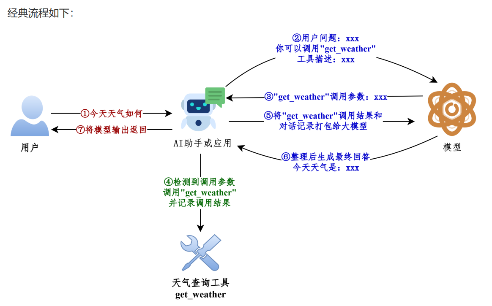

# 第七章、工具Tools

在LangChain中，工具（Tools）实际上是指明确定义了输入和输出的 可调用函数 。因此， 工具调用 (Tool Calling) 也被称为 函数调用(Function Calling) 。

# 1、工具的调用方式

## 方式1：直接调用

这种方式，适合测试时使用。

```python
from langchain_core.tools import tool

@tool
def get_weather(city: str):
    """获取指定城市天气情况"""
    # 你的实现
    return city + "天气晴朗"

ruse = get_weather.invoke({"city": "广州"})
print(ruse)
```

## 方式2：绑定到模型（主流）

这种方式，让AI来调用，开发中使用。

```python
from langchain.chat_models import init_chat_model
from dotenv import load_dotenv
from langchain_core.tools import tool

load_dotenv(override=True)

model = init_chat_model(
    model="gpt-4o-mini",
)

@tool
def get_weather(city: str):
    """获取指定城市天气情况"""
    # 你的实现
    return city + "天气晴朗"

## 模型绑定tool
model_with_tools = model.bind_tools([get_weather])

## AI决定是否调用工具
resp = model_with_tools.invoke("广州今天天气如何?")

## 判断AI是否调用工具
if resp.tool_calls:
    print("AI 调用工具的回答：", resp.tool_calls)
else:
    print("AI直接的回答：", resp.content)
    
    
## 执行结果
AI 调用工具的回答： [{'name': 'get_weather', 'args': {'city': '广州'}, 'id': 'call_5sWon9ZBeW95Id6AXQ2EPIvH', 'type': 'tool_call'}]
```



# 2、工具的定义

使用 @tool 装饰器修饰，可以自动将普通 Python 函数转化为智能体可调用的工具。

此方式 最直接 ，代码量极少，非常适合快速验证想法或创建参数简单的工具。

## 工具的描述信息

### 情况1：仅提供docstring信息

@tool 会从 docstring 生成描述信息，同样要求遵循 Google docstring 规范 。如果没有 docstring则报错，如下。

```python
from langchain_core.tools import tool
from langchain_core.utils.function_calling import convert_to_openai_tool
from rich import print as rprint

@tool
def get_weather(city: str):

    # 你的实现
    return city + "天气晴朗"

rprint(convert_to_openai_tool(get_weather))

# 运行报错：
ValueError: Function must have a docstring if description not provided.
```

补充 docstring

```python
from langchain_core.tools import tool
from langchain_core.utils.function_calling import convert_to_openai_tool
from rich import print as rprint

@tool
def get_weather(city: str):
    """
    天气查询工具
    """
    # 你的实现
    return city + "天气晴朗"

rprint(convert_to_openai_tool(get_weather))

# 运行结果：
{
    'type': 'function',
    'function': {
        'name': 'get_weather',
        'description': '天气查询工具',
        'parameters': {'properties': {'city': {'type': 'string'}}, 'required': ['city'], 'type': 'object'}
    }
}
```

### 情况2：添加工具描述：description

@tool 的参数 description 可以更改工具描述，优先级高于 docstring 的函数说明

```python
from langchain_core.tools import tool
from langchain_core.utils.function_calling import convert_to_openai_tool
from rich import print as rprint

@tool(description="一个天气查询工具")
def get_weather(city: str):
    """
    天气查询工具
    """
    # 你的实现
    return city + "天气晴朗"

rprint(convert_to_openai_tool(get_weather))

# 运行结果：
{
    'type': 'function',
    'function': {
        'name': 'get_weather',
        'description': '一个天气查询工具',
        'parameters': {'properties': {'city': {'type': 'string'}}, 'required': ['city'], 'type': 'object'}
    }
}

```

### 情况3：解析docstring：parse_docstring

当我们没有向 @tool 传递 description 参数时，默认情况下， tool 会将 docstring 整体视为 description ，如下

```python
from langchain_core.tools import tool
from langchain_core.utils.function_calling import convert_to_openai_tool
from rich import print as rprint

@tool
def get_weather(city: str):
    """
    天气查询工具
    Args
        city: 城市名称
    """
    # 你的实现
    return city + "天气晴朗"

rprint(convert_to_openai_tool(get_weather))

# 运行结果：
{
    'type': 'function',
    'function': {
        'name': 'get_weather',
        'description': '天气查询工具\nArgs\n    city: 城市名称',
        'parameters': {'properties': {'city': {'type': 'string'}}, 'required': ['city'], 'type': 'object'}
    }
}
```

通过将 parse_docstring 设置为True，docstring会被解析，填充到相应的字段描述中。

```python
from langchain_core.tools import tool
from langchain_core.utils.function_calling import convert_to_openai_tool
from rich import print as rprint

@tool(parse_docstring=True)
def get_weather(city: str):
    """
    天气查询工具
    
    Args:
        city: 城市名称
    """
    # 你的实现
    return city + "天气晴朗"

rprint(convert_to_openai_tool(get_weather))

# 运行结果
{
    'type': 'function',
    'function': {
        'name': 'get_weather',
        'description': '天气查询工具',
        'parameters': {
            'properties': {'city': {'description': '城市名称', 'type': 'string'}},
            'required': ['city'],
            'type': 'object'
        }
    }
}
```

注意：如果将 parse_docstring 设置为 True，如果 docstring 不合法将抛出异常

```python
from langchain_core.tools import tool
from langchain_core.utils.function_calling import convert_to_openai_tool
from rich import print as rprint

@tool(parse_docstring=True)
def get_weather(city: str):
    """
    天气查询工具

    Args   # 这少了冒号
        city: 城市名称
    """
    # 你的实现
    return city + "天气晴朗"

rprint(convert_to_openai_tool(get_weather))

# 运行报错：
ValueError: Found invalid Google-Style docstring.
```

## 更改工具名称：name_or_callable

默认情况，使用函数名作为工具名称，但可以向@tool 传参 name_or_callable ，以更改工具名称，且优先级高于工具名称。

```python
from langchain_core.tools import tool
from langchain_core.utils.function_calling import convert_to_openai_tool
from rich import print as rprint

@tool(parse_docstring=True, name_or_callable="get_city_weather")
def get_weather(city: str):
    """
    天气查询工具

    Args:
        city: 城市名称
    """
    # 你的实现
    return city + "天气晴朗"

rprint(convert_to_openai_tool(get_weather))

# 运行结果
{
    'type': 'function',
    'function': {
        'name': 'get_city_weather',  # 此时调用的名称是name_or_callable
        'description': '天气查询工具',
        'parameters': {
            'properties': {'city': {'description': '城市名称', 'type': 'string'}},
            'required': ['city'],
            'type': 'object'
        }
    }
}
```

## 自定义args_schema

### 方式1：使用Pydantic模型定义

当工具的参数变得复杂，需要 枚举值 、 范围限制 或 更复杂的业务逻辑验证 时，Pydantic 模型是理想的选择，提供强大的类型检查和数据验证。

使用Pydantic 的主要优势在于能够精确控制工具参数的格式和验证规则，让大模型更准确地理解如何调用工具。

```python
from langchain_core.tools import tool
from langchain_core.utils.function_calling import convert_to_openai_tool
from rich import print as rprint
from pydantic import BaseModel

class WeatherInput(BaseModel):
    city: str

@tool(args_schema=WeatherInput)
def get_weather(city: str):
    """
    天气查询工具
    """
    # 你的实现
    return city + "天气晴朗"

rprint(convert_to_openai_tool(get_weather))

# 运行结果
{
    'type': 'function',
    'function': {
        'name': 'get_weather',
        'description': '天气查询工具',
        'parameters': {'properties': {'city': {'type': 'string'}}, 'required': ['city'], 'type': 'object'}
    }
}
```

Field() ：用来“ 定制字段 ”的函数，可用于设置默认值、描述等。

```python
from langchain_core.tools import tool
from langchain_core.utils.function_calling import convert_to_openai_tool
from rich import print as rprint
from pydantic import BaseModel, Field

class WeatherInput(BaseModel):
    city: str=Field(
        default="北京",
        description="城市"
    )

@tool(args_schema=WeatherInput)
def get_weather(city: str):
    """
    天气查询工具
    """
    # 你的实现
    return city + "天气晴朗"

rprint(convert_to_openai_tool(get_weather))

# 运行结果
{
    'type': 'function',
    'function': {
        'name': 'get_weather',
        'description': '天气查询工具',
        'parameters': {
            'properties': {'city': {'default': '北京', 'description': '城市', 'type': 'string'}},
            'type': 'object'
        }
    }
}
```

Literal ：表示字段不能是任意某种类型的值，而只能是几个固定字面量之一。类似下拉框

```python
from langchain_core.tools import tool
from langchain_core.utils.function_calling import convert_to_openai_tool
from rich import print as rprint
from pydantic import BaseModel, Field
from typing import Literal

class WeatherInput(BaseModel):
    city: str=Field(default="北京", description="城市")
    temperature: Literal["celsius", "fahrenheit"]

@tool(args_schema=WeatherInput)
def get_weather(city: str, temperature: Literal["celsius", "fahrenheit"]):
    """
    天气查询工具
    """
    # 你的实现
    return city + "天气晴朗,气温"+ temperature + "度"

rprint(convert_to_openai_tool(get_weather))

# 运行结果：
{
    'type': 'function',
    'function': {
        'name': 'get_weather',
        'description': '天气查询工具',
        'parameters': {
            'properties': {
                'city': {'default': '北京', 'description': '城市', 'type': 'string'},
                'temperature': {'enum': ['celsius', 'fahrenheit'], 'type': 'string'}
            },
            'required': ['temperature'],
            'type': 'object'
        }
    }
}
```

# 工具的应用案例

## 案例1：使用 args_schema

```python
from dotenv import load_dotenv
from langchain.chat_models import init_chat_model
from langchain_core.messages import HumanMessage
from langchain_core.tools import tool
from pydantic import BaseModel, Field

# 1、读取环境变量
load_dotenv(override=True)

# 2、初始化模型
model = init_chat_model(
    model="gpt-5-mini"
)

# 3、定义args_schema
class WeatherSchema(BaseModel):
    city: str=Field(default="北京", description="城市")
    forecast: bool = Field(default=False,description="是否预测明日天气。如果用户询问了明天的天气，请设为 True，这会同时返回今天和明天的天气。")

# 4、定义工具
@tool(description="天气查询工具", args_schema=WeatherSchema)
def get_weather(city: str, forecast: bool):
    res =  f"{city} 天气晴朗"
    if forecast:
        res += "\n明天阴天"
    return res

# 5、模型绑定工具
model_tools = model.bind_tools([get_weather])

# 6、创建message 消息列表
messages = [HumanMessage("广州今天天气怎么样？明天呢？")]

# 7、将用户消息传递给绑定了tools的模型，得到AIMessage
resp = model_tools.invoke(messages)

# 8、将AIMessage 添加到消息列表
messages.append(resp)

# 9、获取AIMessage中的tool_calls字段信息
tool_calls = resp.tool_calls

# 10、遍历tool_calls，找到名称为工具名称的消息
for tool_call in tool_calls:
    if tool_call["name"] == "get_weather":
        ## 调用工具（因为大模型不能直接调用工具，所以此时我们主动让工具调用执行）
        ## 调用完，返回ToolMessage的实例
        tool_msg = get_weather.invoke(tool_call)
        messages.append(tool_msg)

# 11、调用大模型，得到AIMessage
final_response = model.invoke(messages)

# 12、添加到消息列表
messages.append(final_response)

# 13、遍历消息列表
for msg in messages:
    msg.pretty_print()

# 运行结果
================================ Human Message =================================

广州今天天气怎么样？明天呢？
================================== Ai Message ==================================
Tool Calls:
  get_weather (call_WLSxL4tnx7B7JxZUEJbUyZTt)
 Call ID: call_WLSxL4tnx7B7JxZUEJbUyZTt
  Args:
    city: 广州
    forecast: True
================================= Tool Message =================================
Name: get_weather

广州 天气晴朗
明天阴天
================================== Ai Message ==================================

广州今天晴朗，适合外出；明天阴天，云量较多。  
需要我帮你查具体气温、降雨概率或空气质量等更详细的预报吗？
```

## 案例2：使用docstring

```python
from dotenv import load_dotenv
from langchain.chat_models import init_chat_model
from langchain_core.messages import HumanMessage
from langchain_core.tools import tool

# 1、读取环境变量
load_dotenv(override=True)

# 2、初始化模型
model = init_chat_model(
    model="gpt-5-mini"
)

# 4、定义工具
@tool(parse_docstring=True)
def get_weather(city: str="北京", forecast: bool=False):
    """
    天气查询工具

    Args:
        city: 城市
        forecast: 是否查询明天天气。如果用户询问了明天的天气，请设为 True，这会同时返回今天和明天的天气。
    """
    res =  f"{city} 天气晴朗"
    if forecast:
        res += "\n明天阴天"
    return res

# 5、模型绑定工具
model_tools = model.bind_tools([get_weather])

# 6、创建message 消息列表
messages = [HumanMessage("广州今天天气怎么样？明天呢？")]

# 7、将用户消息传递给绑定了tools的模型，得到AIMessage
resp = model_tools.invoke(messages)

# 8、将AIMessage 添加到消息列表
messages.append(resp)

# 9、获取AIMessage中的tool_calls字段信息
tool_calls = resp.tool_calls

# 10、遍历tool_calls，找到名称为工具名称的消息
for tool_call in tool_calls:
    if tool_call["name"] == "get_weather":
        ## 调用工具（因为大模型不能直接调用工具，所以此时我们主动让工具调用执行）
        ## 调用完，返回ToolMessage的实例
        tool_msg = get_weather.invoke(tool_call)
        messages.append(tool_msg)

# 11、调用大模型，得到AIMessage
final_response = model.invoke(messages)

# 12、将AIMessage添加到消息列表
messages.append(final_response)

# 13、遍历消息列表
for msg in messages:
    msg.pretty_print()

# 运行结果
================================ Human Message =================================

广州今天天气怎么样？明天呢？
================================== Ai Message ==================================
Tool Calls:
  get_weather (call_UBSEZclpXZREYnpNYjflgB9Q)
 Call ID: call_UBSEZclpXZREYnpNYjflgB9Q
  Args:
    city: 广州
    forecast: True
================================= Tool Message =================================
Name: get_weather

广州 天气晴朗
明天阴天
================================== Ai Message ==================================

广州今天晴朗，适合外出，记得防晒和多喝水。明天是阴天，光线较暗、可能凉些，出门前再看下最新预报，视情况带件外套或雨具。
```
