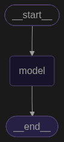

# 第九章、Agent 智能体

# 1、什么是Agent ?

在大模型开发中，Agent（智能体）是指**一个以大型语言模型（LLM）为核心大脑，具备自主理解、规划、记忆并能调用工具来执行复杂任务的软件实体**。

## Agent的关键能力

- 理解用户问题
- 如何 拆解任务
- 判断 是否需要工具
- 需要 调用哪些工具
- 如何利用好 工具结果 生成回答&推进任务

## Agent的核心组件

在大模型开发中，业界公认的 Agent 核心架构由**大脑（LLM）、规划（Planning）、记忆（Memory）和工具（Tools）**四大组件构成。

我们可以将 Agent 比作一个**职场员工**，通过以下四个核心组件的协作来完成工作：

---

### **1. 🧠 大脑 (LLM / Core Controller)**

这是 Agent 的**控制中心与决策引擎**。

- **职责**：负责理解用户的自然语言输入，进行逻辑推理、意图识别，并决定下一步该做什么（是思考、查记忆、调工具还是直接回复）。
- **核心技术**：依托大模型的高级指令遵循能力、少样本学习（Few-shot）能力以及生成结构化数据（如 JSON/Function Call）的能力。

### **2. 📝 规划 (Planning)**

规划组件赋予了 Agent **拆解复杂任务和自我纠错**的能力，使其不至于“走一步算一步”。

- **子任务拆解**：将用户模糊的宏观目标（如“帮我写一份竞品分析报告”）拆解为可执行的微观步骤（步骤 A：搜索行业数据 -> 步骤 B：提取表格 -> 步骤 C：生成对比结论）。
- **经典思维模式**：
    - **CoT (Chain of Thought，思维链)**：让模型“一步一步地思考”，提高复杂推理的准确率。
    - **ReAct (Reason + Act)**：将“思考”与“行动”交替进行。模型先思考（Reason），然后决定采取行动（Act/调工具），观察工具返回的结果（Obs），再进行下一步思考。
- **自我反思与纠错 (Reflection)**：当工具报错或结果不符合预期时，Agent 能识别错误并自主调整策略（例如：换一个搜索关键词或换一个 API 重新尝试）。

### **3. 💾 记忆 (Memory)**

记忆组件解决了大模型“随聊随忘”的痛点，让 Agent 能够**沉淀上下文和历史经验**。

- **短期记忆 (Short-term Memory)**：
    - **概念**：当前任务执行过程中的上下文信息。
    - **实现**：通常存储在 Prompt 的 Context Window 中，记录当下已经完成了哪些步骤、拿到了什么中间数据。
- **长期记忆 (Long-term Memory)**：
    - **概念**：跨越很长时间、甚至跨越多个不同任务都需要记住的信息。
    - **实现**：通过向量数据库 (Vector Database) 外部存储来实现。它可以保存用户的个人偏好、企业的标准操作流程（SOP）、或者过去成功/失败的历史经验，在需要时通过语义检索（RAG）唤醒。

### **4. 🛠️ 工具 / 行动 (Tools / Actions)**

这是 Agent 的“手脚”，让它能够**打破模型自身的知识边界，与物理或数字世界产生真实交互**。

- **职责**：大模型本身无法直接联网或运行代码，但它可以通过输出特定格式（如 JSON）来“表达”它想使用什么工具。外部系统接收到这个指令后代为执行，并将结果喂回给大模型。
- **常见工具类型**：
    - **网络检索**：搜索引擎（如 Google / Bing API）、网页爬虫。
    - **计算与代码**：Python 代码执行沙盒（Code Interpreter）、计算器。
    - **业务 API**：天气查询、机票预订、数据库 SQL 查询、发送邮件/Slack 消息等。

---

### **🧱 核心组件协作流程示例（ReAct 模式）**

当用户对 Agent 说：*“帮我查一下今天香港的天气，并根据天气发一封邮件给我的客户张总。”*

1. **大脑（LLM）** 接收输入，**规划（Planning）** 组件将其拆解为两个任务：查天气、发邮件。
2. **大脑** 决定调用工具，触发 **工具（Tools）**：调用天气 API 查到了香港今天有雨。
3. **记忆（Memory）** 组件被唤醒，从长期记忆（数据库）中检索出“客户张总”的邮箱地址。
4. **大脑** 结合天气结果和邮箱地址，生成邮件正文，再次触发 **工具（Tools）**：调用邮件 API 将邮件发送出去。
5. Agent 向用户汇报完成。

# 2、Agent的创建和调用

在 **LangChain 1.x** 中，通常用 `create_agent()` 创建 Agent，再用 **`invoke()`** 或 **`stream()`** 调用。输入统一使用 `messages` 格式。

## 1、传入模型名称创建Agent

```python
from dotenv import load_dotenv
from langchain.agents import create_agent

load_dotenv(override=True)

agent = create_agent(
    model="gpt-4o-mini"
)

print(agent)

# 运行结果
<langgraph.graph.state.CompiledStateGraph object at 0x000001FD3B614CD0>
```

 画出创建调用示意图

```python
from IPython.display import Image, display
display(Image(agent.get_graph().draw_mermaid_png()))
```



## 2、传入模型对象创建Agent

```python
from langchain.chat_models import init_chat_model

load_dotenv(override=True)

model = init_chat_model(
    model="gpt-4o-mini",
)

agent = create_agent(
    model=model,
)

print(agent)

# 运行结果
<langgraph.graph.state.CompiledStateGraph object at 0x000001FD3B6165D0>
```

## 3、使用 **invoke** 调用Agent

```python
from langchain.chat_models import init_chat_model
from rich import print as rprint

load_dotenv(override=True)

model = init_chat_model(
    model="gpt-4o-mini",
)

agent = create_agent(
    model=model,
)

response = agent.invoke({"messages": ["你好"]})

print(type(response))
rprint(response)
# rprint(response['messages'][-1].content)

# 运行结果
<class 'dict'>

{
    'messages': [
        HumanMessage(
            content='你好',
            additional_kwargs={},
            response_metadata={},
            id='994c586c-e2ef-4357-be82-05947207eb53'
        ),
        AIMessage(
            content='你好！有什么我可以帮助你的吗？',
            additional_kwargs={'refusal': None},
            response_metadata={
                'token_usage': {
                    'completion_tokens': 10,
                    'prompt_tokens': 8,
                    'total_tokens': 18,
                    'completion_tokens_details': {
                        'accepted_prediction_tokens': None,
                        'audio_tokens': None,
                        'reasoning_tokens': 0,
                        'rejected_prediction_tokens': None,
                        'text_tokens': None
                    },
                    'prompt_tokens_details': {
                        'audio_tokens': None,
                        'cache_write_tokens': 0,
                        'cached_tokens': 0,
                        'image_tokens': None,
                        'text_tokens': None
                    }
                },
                'model_provider': 'openai',
                'model_name': 'gpt-4o-mini',
                'system_fingerprint': None,
                'id': 'chatcmpl-EMPl4OSQ9y3xALocyilcv1ddt2ao5',
                'service_tier': 'default',
                'finish_reason': 'stop',
                'logprobs': None
            },
            id='lc_run--01a0895c-8899-7402-9194-4420f1aa6f81-0',
            tool_calls=[],
            invalid_tool_calls=[],
            usage_metadata={
                'input_tokens': 8,
                'output_tokens': 10,
                'total_tokens': 18,
                'input_token_details': {'cache_read': 0, 'cache_creation': 0},
                'output_token_details': {'reasoning': 0}
            }
        )
    ]
}
```

invoke调用的核心就是输入一系列消息（messages），每条消息通常包含 role（如 "user", "assistant", "system", "tool"）和 "content"。

```python
from langchain.chat_models import init_chat_model
from rich import print as rprint

load_dotenv(override=True)

model = init_chat_model(
    model="gpt-4o-mini",
)

agent = create_agent(
    model=model,
)

response = agent.invoke(
    {
        "messages": [
            {"role": "system", "content": "你是一个数学老师，请解答用户的数学问题。"},
            {"role": "user", "content": "2+3-5*0=?"}
        ]
    }
)

print(type(response))
# rprint(response)
rprint(response['messages'][-1].content)

# 运行结果
<class 'dict'>

根据数学运算的优先顺序，首先进行乘法运算，然后进行加法和减法。

在这个表达式中：
1. 计算乘法: \(5*0 = 0\)
2. 然后按顺序进行加法和减法: \(2 + 3 - 0 = 5\)

所以，\(2 + 3 - 5*0 = 5\)。
```

# 3、Agent 绑定工具

Agent支持 静态 和 动态 绑定工具，支持绑定一个或多个工具

```python
from langchain_core.tools import tool
from langchain.chat_models import init_chat_model
from rich import print as rprint

load_dotenv(override=True)

@tool(parse_docstring=True)
def get_weather(city: str):
    """
    天气查询工具

    Args:
        city: 城市名称
    """
    # 具体实现
    return city + "天气晴朗。"

model = init_chat_model(
    model="gpt-4o-mini",

)

agent = create_agent(
    model=model,
    tools=[get_weather]
)

response = agent.invoke(
    {
        "messages": [
            {"role": "system", "content": "你是一个天气查询助手，请解答用户的问题。如果用户的问题和天气无关，请委婉的拒绝回答。"},
            {"role": "user", "content": "广州天气怎么样?"}
        ]
    }
)

#print(type(response))
rprint(response)
#rprint(response['messages'][-1].content)

# 运行结果
{
    'messages': [
        SystemMessage(
            content='你是一个天气查询助手，请解答用户的问题。如果用户的问题和天气无关，请委婉的拒绝回答。',
            additional_kwargs={},
            response_metadata={},
            id='735540f3-8a5d-4b47-9fa6-cdab8a2d2636'
        ),
        HumanMessage(
            content='广州天气怎么样?',
            additional_kwargs={},
            response_metadata={},
            id='166aae6a-1f07-4ef3-9dc3-c564ce7cb166'
        ),
        AIMessage(
            content='',
            additional_kwargs={'refusal': None},
            response_metadata={
                'token_usage': {
                    'completion_tokens': 15,
                    'prompt_tokens': 78,
                    'total_tokens': 93,
                    'completion_tokens_details': {
                        'accepted_prediction_tokens': None,
                        'audio_tokens': None,
                        'reasoning_tokens': 0,
                        'rejected_prediction_tokens': None,
                        'text_tokens': None
                    },
                    'prompt_tokens_details': {
                        'audio_tokens': None,
                        'cache_write_tokens': 0,
                        'cached_tokens': 0,
                        'image_tokens': None,
                        'text_tokens': None
                    }
                },
                'model_provider': 'openai',
                'model_name': 'gpt-4o-mini',
                'system_fingerprint': None,
                'id': 'chatcmpl-EMQAThuvhSTLBegeyjfoVZpF6WUmG',
                'service_tier': 'default',
                'finish_reason': 'tool_calls',
                'logprobs': None
            },
            id='lc_run--01a08974-8d84-7dd2-8c6b-b39e3725b8b6-0',
            tool_calls=[
                {
                    'name': 'get_weather',
                    'args': {'city': '广州'},
                    'id': 'call_z3Lz5bVdU79mEx3WdM7YNJNn',
                    'type': 'tool_call'
                }
            ],
            invalid_tool_calls=[],
            usage_metadata={
                'input_tokens': 78,
                'output_tokens': 15,
                'total_tokens': 93,
                'input_token_details': {'cache_read': 0, 'cache_creation': 0},
                'output_token_details': {'reasoning': 0}
            }
        ),
        ToolMessage(
            content='广州天气晴朗。',
            name='get_weather',
            id='83cb0239-feea-455a-9119-a4b2e3de1459',
            tool_call_id='call_z3Lz5bVdU79mEx3WdM7YNJNn'
        ),
        AIMessage(
            content='广州的天气晴朗。',
            additional_kwargs={'refusal': None},
            response_metadata={
                'token_usage': {
                    'completion_tokens': 8,
                    'prompt_tokens': 105,
                    'total_tokens': 113,
                    'completion_tokens_details': {
                        'accepted_prediction_tokens': None,
                        'audio_tokens': None,
                        'reasoning_tokens': 0,
                        'rejected_prediction_tokens': None,
                        'text_tokens': None
                    },
                    'prompt_tokens_details': {
                        'audio_tokens': None,
                        'cache_write_tokens': 0,
                        'cached_tokens': 0,
                        'image_tokens': None,
                        'text_tokens': None
                    }
                },
                'model_provider': 'openai',
                'model_name': 'gpt-4o-mini',
                'system_fingerprint': None,
                'id': 'chatcmpl-EMQAVvPUzM3pUM2k6UaZ8nnQETjch',
                'service_tier': 'default',
                'finish_reason': 'stop',
                'logprobs': None
            },
            id='lc_run--01a08974-95e0-7642-b2c5-b293c28b3234-0',
            tool_calls=[],
            invalid_tool_calls=[],
            usage_metadata={
                'input_tokens': 105,
                'output_tokens': 8,
                'total_tokens': 113,
                'input_token_details': {'cache_read': 0, 'cache_creation': 0},
                'output_token_details': {'reasoning': 0}
            }
        )
    ]
}
```

上述代码调用图例

```python
from IPython.display import Image, display
display(Image(agent.get_graph().draw_mermaid_png()))
```


# 4、绑定多个工具

```python
from langchain_core.tools import tool
from langchain.chat_models import init_chat_model
from rich import print as rprint

load_dotenv(override=True)

@tool(parse_docstring=True)
def get_weather(city: str):
    """
    天气查询工具

    Args:
        city: 城市名称
    """
    # 具体实现
    return city + "天气晴朗。"

@tool(parse_docstring=True)
def get_news(city: str):
    """
    新闻查询工具

    Args:
        city: 城市名称
    """
    # 具体实现
    return city + "金秋文旅消费季即将启动，将投放文旅消费券，并发布百余个文旅招商重点项目。"

model = init_chat_model(
    model="gpt-4o-mini",

)

agent = create_agent(
    model=model,
    tools=[get_weather,get_news]
)

response = agent.invoke(
    {
        "messages": ["广州今天天气如何？有哪些新闻？"]
    }
)
rprint(response['messages'][-1].content)

# 运行结果
今天广州的天气晴朗。

关于新闻，广州即将启动金秋文旅消费季，将投放文旅消费券，并发布百余个文旅招商重点项目。
```

# 5、调用内置工具

以 TavilySearch 为例。Tavily Search 是**一个专为大型语言模型（LLM）和 AI 代理（AI Agent）优化的搜索引擎 API**

```python
from langchain.chat_models import init_chat_model
from rich import print as rprint
from langchain_tavily import TavilySearch
import os

load_dotenv(override=True)

llm = init_chat_model(
    model="gpt-4o-mini",
)

web_search = TavilySearch(
    max_retries=3,
    tavily_api_key=os.getenv("TAVILY_API_KEY"),  ## 登陆https://www.tavily.com网站，获取tavily api，写入.env文件
)

agent = create_agent(
    model=llm,
    tools=[web_search]
)

response = agent.invoke(
    {
        "messages": [
            {"role": "user", "content": "请帮我查询2024年诺贝尔文学奖得主是谁？"}
        ]
    }
)

rprint(response["messages"][-1].content)

# 运行结果
2024年诺贝尔文学奖得主是韩国作家韩江（Han Kang）。瑞典文学院在10月10日宣布这个消息，以表彰她以强烈的诗意散文直面历史创伤，揭示了人类生命的脆弱性。韩江是第一
位获得诺贝尔文学奖的韩国作家，也是第18位女性获奖者。
```


# 6、Agent高级用法

## 6.1、设置Agent名称

```python
agent = create_agent(
    model=llm,
    tools=[web_search],
    name="web_search_agent"
)
```

## 6.2、Agent系统提示词

```python
agent = create_agent(
    model=llm,
    tools=[web_search],
    name="web_search_agent",
    system_prompt="""
    你是天气助手。
    工作流程：
		1. 理解用户的城市查询
		2. 使用 get_weather 工具获取数据
		3. 简洁清晰地回答
		输出格式：
		- 天气状况
		- 温度
		- 注意事项（如有）
"""

)
```

## 6.4、Agent结构化输出


### 6.4.1、ProviderStrategy

ProviderStrategy是模型提供商的 `原生结构化输出功能` 实现结构化输出

```python
from pydantic import BaseModel, Field
from langchain_core.tools import tool
from langchain.chat_models import init_chat_model
from rich import print as rprint
from langchain.agents.structured_output import ProviderStrategy

load_dotenv(override=True)

model = init_chat_model(
    model="gpt-4o-mini",
)

# 使用pydantic结构化方式定义
class UserInfo(BaseModel):
    """用户信息"""
    name: str =Field(description="姓名")
    email: str = Field(description="邮箱")
    phone: str = Field(description="电话")

agent = create_agent(
    model=model,
    response_format=ProviderStrategy(UserInfo)
)

response = agent.invoke({
    "messages": [
        "从这段话中抽取结构化信息：小明的邮箱地址为：shkstart@atguigu.com，手机号：12345678912"
    ]
})

rprint(response['messages'][-1].content)

# 运行结果
{"name":"小明","email":"shkstart@atguigu.com","phone":"12345678912"}
```

### 6.4.2、ToolStrategy

对于不支持原生结构化输出的模型，LangChain采用 ToolStrategy 工具调用的方式实现结构化输出。模拟工具调用的方式

```python
from pydantic import BaseModel, Field
from langchain.chat_models import init_chat_model
from rich import print as rprint
from langchain.agents.structured_output import ToolStrategy
from langchain_core.messages import HumanMessage

load_dotenv(override=True)

model = init_chat_model(
    model="gpt-4o-mini",
)

# 使用pydantic结构化方式定义
class UserInfo(BaseModel):
    """用户信息"""
    name: str =Field(description="姓名")
    email: str = Field(description="邮箱")
    phone: str = Field(description="电话")

agent = create_agent(
    model=model,
    response_format=ToolStrategy(UserInfo)
)

response = agent.invoke({
    "messages": [
        HumanMessage("从这段话中抽取结构化信息：小明的邮箱地址为：shkstart@atguigu.com，手机号：12345678912")
    ]
})

rprint(response['messages'][-1].content)

# 运行结果
Returning structured response: name='小明' email='shkstart@atguigu.com' phone='12345678912'6.4.3
```

### 6.4.3、AutoStrategy

AutoStrategy 会根据模型自动选择策略

```python
from pydantic import BaseModel, Field
from langchain.chat_models import init_chat_model
from rich import print as rprint
from langchain.agents.structured_output import AutoStrategy
from langchain_core.messages import HumanMessage

load_dotenv(override=True)

model = init_chat_model(
    model="gpt-4o-mini",
)

# 使用pydantic结构化方式定义
class UserInfo(BaseModel):
    """用户信息"""
    name: str =Field(description="姓名")
    email: str = Field(description="邮箱")
    phone: str = Field(description="电话")

agent = create_agent(
    model=model,
    response_format=AutoStrategy(UserInfo)
)

response = agent.invoke({
    "messages": [
        HumanMessage("从这段话中抽取结构化信息：小明的邮箱地址为：shkstart@atguigu.com，手机号：12345678912")
    ]
})

rprint(response['messages'][-1].content)
```

### 6.4.4、直接传递

特别注意：在LangChain 1.x及以上版本中，直接传递模式（如response_format=ContactInfo）不再支持，必须显式使用ToolStrategy或ProviderStrategy。

（经过测试，目前LangChain 1.4版本还可使用）

```python
from pydantic import BaseModel, Field
from langchain.chat_models import init_chat_model
from rich import print as rprint
from langchain_core.messages import HumanMessage

load_dotenv(override=True)

model = init_chat_model(
    model="gpt-4o-mini",
)

# 使用pydantic结构化方式定义
class UserInfo(BaseModel):
    """用户信息"""
    name: str =Field(description="姓名")
    email: str = Field(description="邮箱")
    phone: str = Field(description="电话")

agent = create_agent(
    model=model,
    response_format=UserInfo    # 直接传递
)

response = agent.invoke({
    "messages": [
        HumanMessage("从这段话中抽取结构化信息：小明的邮箱地址为：shkstart@atguigu.com，手机号：12345678912")
    ]
})

rprint(response['messages'][-1].content)
```

| **特性** | **ProviderStrategy (厂商原生策略)** | **ToolStrategy (工具调用策略)** |
| --- | --- | --- |
| **实现原理** | 调用厂商原生的结构化接口（如 `response_format`） | 将 Schema 包装成一个“虚构工具”，欺骗模型去调用 |
| **可靠性** | **最高**。厂商底层强校验，几乎 100% 遵循 Schema | **中等**。依赖模型理解并正确填写工具参数的能力 |
| **模型兼容性** | **有限**。仅支持提供原生结构化接口的闭源/前沿模型 | **极高**。只要模型支持工具调用（Function Calling）就能用 |
| **使用场景** | 追求最高成功率，且使用的模型原生支持该功能 | 模型不支持原生结构化，或需要高度通用的代码时 |

### **两种 Strategy 的适用场景**

• **优先选用 `ToolStrategy` 的场景：**
    1. 使用非 OpenAI/Anthropic 模型（如开源部署的 DeepSeek、Qwen 或本地 Ollama）。
    2. Agent 既需要做多步工具调用推理（Multi-step tool calling），又需要在最终结果输出特定 Schema。
    3. 需要 Agent 在解析 Schema 失败时具备自行修正重试（Error recovery）的健壮性。

• **选用 `ProviderStrategy` 的场景：**  
    1. 模型原生对 JSON Schema / Strict Output 的支持极佳（如 OpenAI `gpt-4o` 且开启了 `strict: true`）。
    2. **追求极高格式精准度**（希望 100% 遵守 Schema 规则，不产生多余 Markdown 格式）。  
    3. 任务属于**单次提取/分类任务**（更偏向模型直接输出，而非复杂的循环推理 Agent）。

## 6.5、ToolStrategy高级特性

ToolStrategy的配置包含三个主要参数：

```python
# ToolStrategy源码
langchain.agents.structured_output.ToolStrategy
def __init__(self,
             schema: type[SchemaT] | UnionType | dict[str, Any],
             *,
             tool_message_content: str | None = None,
             handle_errors: bool | str | type[Exception] | tuple[type[Exception], ...] | (Exception) -> str = True)
  -> None
```

- schema（必需参数）：与提供商策略的schema参数功能一致，支持 Pydantic模型 、TypedDict 、 JSON Schema 、 数据类(@dataclass) ，同时还支持联合类型  Union[类型1, 类型2] （允许模型根据输入内容选择最匹配的数据结构）。
- tool_message_content（可选参数）：用于自定义生成结构化输出时，会话历史中记录的提示信息。默认使用展示输出数据的标准响应语句。
- handle_errors（可选参数）：用于指定数据校验失败时的重试策略， 默认值为True

### 6.5.1、Pydantic类型

Pydantic类型的Schema支持数据验证，是优先推荐使用的方式

```python
from pydantic import BaseModel, Field
from langchain.chat_models import init_chat_model
from rich import print as rprint
from langchain.agents.structured_output import ToolStrategy
from langchain_core.messages import HumanMessage

load_dotenv(override=True)

model = init_chat_model(
    model="gpt-4o-mini",
)

# 使用pydantic结构化方式定义
class UserInfo(BaseModel):
    """用户信息"""
    name: str =Field(description="姓名")
    email: str = Field(description="邮箱")
    phone: str = Field(description="电话")

agent = create_agent(
    model=model,
    response_format=ToolStrategy(UserInfo)
)

response = agent.invoke({
    "messages": [
        HumanMessage("从这段话中抽取结构化信息：小明的邮箱地址为：shkstart@atguigu.com，手机号：12345678912")
    ]
})

# rprint(response['messages'][-1].content)
for msg in response['messages']:
    msg.pretty_print()
    
    
# 运行结果
================================ Human Message =================================

从这段话中抽取结构化信息：小明的邮箱地址为：shkstart@atguigu.com，手机号：12345678912
================================== Ai Message ==================================
Tool Calls:
  UserInfo (call_j27Pj7JfrxpwQhYCoRt9SaUV)
 Call ID: call_j27Pj7JfrxpwQhYCoRt9SaUV
  Args:
    email: shkstart@atguigu.com
    name: 小明
    phone: 12345678912
================================= Tool Message =================================
Name: UserInfo

Returning structured response: name='小明' email='shkstart@atguigu.com' phone='12345678912'
```

观察日志可知，这种方式将结构化信息作为 伪工具传递 ，显然使用了Function Calling方法。

### 6.5.2、TypedDict类型

TypedDict 允许为字典对象定义固定的键名和对应的 值类型 ，是 带有类型提示的字典结构 。具体的：

1. TypedDict字段定义采用 Annotated[类型, 默认值, "描述"]格式
2. 可选字段使用 Optional包装，默认值在 Annotated 中指定
3. TypedDict 不支持运行时验证。

```python
from pydantic import BaseModel, Field
from langchain.chat_models import init_chat_model
from rich import print as rprint
from langchain.agents.structured_output import ToolStrategy
from langchain_core.messages import HumanMessage
from typing import TypedDict,Annotated

load_dotenv(override=True)

model = init_chat_model(
    model="gpt-4o-mini",
)

# 定义TypedDict类型
class UserInfo(TypedDict):
    """用户信息"""
    name: Annotated[str, ..., "姓名"]
    email: Annotated[str, ...,"邮箱"]
    phone: Annotated[str, ...,"电话"]

agent = create_agent(
    model=model,
    response_format=ToolStrategy(UserInfo)
)

response = agent.invoke({
    "messages": [
        HumanMessage("从这段话中抽取结构化信息：小明的邮箱地址为：shkstart@atguigu.com，手机号：12345678912")
    ]
})

# rprint(response['messages'][-1].content)
for msg in response['messages']:
    msg.pretty_print()
    
# 运行结果
================================ Human Message =================================

从这段话中抽取结构化信息：小明的邮箱地址为：shkstart@atguigu.com，手机号：12345678912
================================== Ai Message ==================================
Tool Calls:
  UserInfo (call_i2ogm3baaFGf8MNbzT2Ajfbd)
 Call ID: call_i2ogm3baaFGf8MNbzT2Ajfbd
  Args:
    email: shkstart@atguigu.com
    name: 小明
    phone: 12345678912
================================= Tool Message =================================
Name: UserInfo

Returning structured response: {'name': '小明', 'email': 'shkstart@atguigu.com', 'phone': '12345678912'}
```

### 6.5.3、@dataclass类型

@dataclass是Python 3.7引入的一个装饰器，用于简化数据存储类的定义。

```python
from pydantic import BaseModel, Field
from langchain.chat_models import init_chat_model
from rich import print as rprint
from langchain.agents.structured_output import ToolStrategy
from langchain_core.messages import HumanMessage
from typing import TypedDict,Annotated
from dataclasses import dataclass

load_dotenv(override=True)

model = init_chat_model(
    model="gpt-4o-mini",
)

@dataclass
class UserInfo:
    """用户信息"""
    name: str = Field(description="姓名")
    email: str =Field(description="邮箱")
    phone: str =Field(description="手机号")

agent = create_agent(
    model=model,
    response_format=ToolStrategy(UserInfo)
)

response = agent.invoke({
    "messages": [
        HumanMessage("从这段话中抽取结构化信息：小明的邮箱地址为：shkstart@atguigu.com，手机号：12345678912")
    ]
})

# rprint(response['messages'][-1].content)
for msg in response['messages']:
    msg.pretty_print()
    
# 运行结果
================================ Human Message =================================

从这段话中抽取结构化信息：小明的邮箱地址为：shkstart@atguigu.com，手机号：12345678912
================================== Ai Message ==================================
Tool Calls:
  UserInfo (call_JTTGdfQme7esXbi08moVqIWe)
 Call ID: call_JTTGdfQme7esXbi08moVqIWe
  Args:
    email: shkstart@atguigu.com
    name: 小明
    phone: 12345678912
================================= Tool Message =================================
Name: UserInfo

Returning structured response: UserInfo(name='小明', email='shkstart@atguigu.com', phone='12345678912')
```

### TypedDict  Pydantic  Dataclass 三者的区别

| **维度** | **TypedDict** | **Dataclass** | **Pydantic (BaseModel)** |
| --- | --- | --- | --- |
| **底层数据类型** | **原生 `dict`** | 自定义对象 (Object) | 自定义对象 (Object) |
| **运行时校验** | **无**（仅在静态检查时报错） | **无** | **有**（自动转换类型、抛出异常） |
| **访问方式** | `obj["key"]` | `obj.key` | `obj.key` |
| **性能开销** | **零**（无实例化耗时） | 极低 | 低（带数据校验逻辑） |
| **典型使用场景** | JSON 接口数据处理、LangChain State | 内部数据传输对象 (DTO) | API 请求参数校验、配置文件解析 |

### 6.5.4、自定义工具消息：tool_message_content参数

```python
from pydantic import BaseModel, Field
from langchain.chat_models import init_chat_model
from rich import print as rprint
from langchain.agents.structured_output import ToolStrategy
from langchain_core.messages import HumanMessage
from typing import TypedDict,Annotated
from dataclasses import dataclass

load_dotenv(override=True)

model = init_chat_model(
    model="gpt-4o-mini",
)

@dataclass
class UserInfo:
    """用户信息"""
    name: str = Field(description="姓名")
    email: str =Field(description="邮箱")
    phone: str =Field(description="手机号")

agent = create_agent(
    model=model,
    response_format=ToolStrategy(UserInfo, tool_message_content="已成功获取信息")
)

response = agent.invoke({
    "messages": [
        HumanMessage("从这段话中抽取结构化信息：小明的邮箱地址为：shkstart@atguigu.com，手机号：12345678912")
    ]
})

rprint(response)
# for msg in response['messages']:
#     msg.pretty_print()

# 运行结果
{
    'messages': [
        HumanMessage(
            content='从这段话中抽取结构化信息：小明的邮箱地址为：shkstart@atguigu.com，手机号：12345678912',
            additional_kwargs={},
            response_metadata={},
            id='47db50c5-4449-4029-a2c4-e9e3640e5eaf'
        ),
        AIMessage(
            content='',
            additional_kwargs={'refusal': None},
            response_metadata={
                'token_usage': {
                    'completion_tokens': 49,
                    'prompt_tokens': 91,
                    'total_tokens': 140,
                    'completion_tokens_details': {
                        'accepted_prediction_tokens': None,
                        'audio_tokens': None,
                        'reasoning_tokens': 0,
                        'rejected_prediction_tokens': None,
                        'text_tokens': None
                    },
                    'prompt_tokens_details': {
                        'audio_tokens': None,
                        'cache_write_tokens': 0,
                        'cached_tokens': 0,
                        'image_tokens': None,
                        'text_tokens': None
                    }
                },
                'model_provider': 'openai',
                'model_name': 'gpt-4o-mini',
                'system_fingerprint': None,
                'id': 'chatcmpl-ENrmvTZzgjStIsCmZ8iNpkI7fx27R',
                'service_tier': 'default',
                'finish_reason': 'tool_calls',
                'logprobs': None
            },
            id='lc_run--01a09dfd-3549-7cf0-9aeb-d3f87943f759-0',
            tool_calls=[
                {
                    'name': 'UserInfo',
                    'args': {'email': 'shkstart@atguigu.com', 'name': '小明', 'phone': '12345678912'},
                    'id': 'call_G2nfq9Vj57XYghm9ZFG2rGeh',
                    'type': 'tool_call'
                }
            ],
            invalid_tool_calls=[],
            usage_metadata={
                'input_tokens': 91,
                'output_tokens': 49,
                'total_tokens': 140,
                'input_token_details': {'cache_read': 0, 'cache_creation': 0},
                'output_token_details': {'reasoning': 0}
            }
        ),
        ToolMessage(
            content='已成功获取信息',    # 默认会附带上整个返回结果，既消耗token又不美观，所以自定义Tool消息
            name='UserInfo',
            id='cfae05f4-51c1-41d6-a2cc-0d03ec0e8ac8',
            tool_call_id='call_G2nfq9Vj57XYghm9ZFG2rGeh'
        )
    ],
    'structured_response': UserInfo(name='小明', email='shkstart@atguigu.com', phone='12345678912')
}
```

### 6.5.5、错误处理：handle_errors参数

受限于模型能力，大模型输出的内容可能并 不符合格式要求 ，ToolStrategy通过其 handle_errors参数 提供了结构化过程错误处理策略，以下是主要的几种方式及其用途：

- handle_errors=True： LangChain 默认方式 ， 捕获所有异常 ，并使用LangChain 内置的、信息明确的 错误消息模板 提示模型重试，确保最终能得到符合预定格式的有效数据。适用于大多数希望自动处理错误的通用场景。
- handle_errors=False：关闭自动重试机制，任何异常都会 直接抛出 ，会 中断程序 运行。
- handle_errors="自定义字符串"：捕获所有异常，但使用开发者 预设的固定字符串 作为错误消息。适用于需要统一、友好的用户提示，或进行特定业务引导的场景。
- handle_errors=ExceptionType：仅 捕获指定类型(如ValueError) 或元组中的异常类型并进行重试， 其他异常直接抛出 。适用于需要 精准控制 ，只对特定错误进行重试的场景。
- handle_errors=callable：灵活性最高的方式，使用开发者 自定义的函数来处理异常 ，可根据不同的异常类型返回差异化的提示信息。适用于需要复杂、精细化错误处理的场景。

#### handle_errors=True

```python
from pydantic import BaseModel, Field
from langchain.chat_models import init_chat_model
from rich import print as rprint
from langchain.agents.structured_output import ToolStrategy
from langchain_core.messages import HumanMessage
from typing import TypedDict,Annotated,Union
from dotenv import load_dotenv
from langchain.agents import create_agent

load_dotenv(override=True)

model = init_chat_model(
    model="gpt-5-mini",
)

class UserInfo(BaseModel):
    """员工信息"""
    name: str = Field(description="姓名")
    phone: str =Field(description="手机")

class EventInfo(BaseModel):
    """活动信息"""
    event_name: str = Field(description="活动名称")
    event_date: str = Field(description="活动日期")

agent = create_agent(
    model=model,
    response_format=ToolStrategy(
        Union[UserInfo, EventInfo],    # Union 只能选择一个，所以会报错
        tool_message_content="已成功获取信息",
        handle_errors=True,
    )
)

response = agent.invoke({
    "messages": [
        HumanMessage("从这段话中抽取结构化信息：小明的邮箱地址为：shkstart@atguigu.com，手机号：12345678912。活动名称：公司年会，活动日期：2026-07-15")
    ]
})

rprint(response)

# 运行结果
ToolMessage(
            content='Error: Model incorrectly returned multiple structured responses (UserInfo, EventInfo) when 
only one is expected.\n Please fix your mistakes.',
            name='UserInfo',
            id='72a4c671-5a2e-4c43-97dc-4a45b69d0634',
            tool_call_id='call_uhKfltq5wSeApJ3pHXsdZiTa'
        ),
        ToolMessage(
            content='Error: Model incorrectly returned multiple structured responses (UserInfo, EventInfo) when 
only one is expected.\n Please fix your mistakes.',
            name='EventInfo',
            id='4346245d-0260-45b6-828e-3d0c90de823d',
            tool_call_id='call_eo0WLI2lZTs1nd9VMCQB5d9N'
        ),
```

#### handle_errors=False

```python
agent = create_agent(
    model=model,
    response_format=ToolStrategy(
        Union[UserInfo, EventInfo],
        tool_message_content="已成功获取信息",
        handle_errors=False,
    )
)

#运行结果
MultipleStructuredOutputsError: Model incorrectly returned multiple structured responses (UserInfo, EventInfo) when only one is expected.
During task with name 'model' and id 'b113454a-d988-d6ba-7278-5f2ce865cbe0'
```

#### handle_errors=”自定义字符串”

```python
agent = create_agent(
    model=model,
    response_format=ToolStrategy(
        Union[UserInfo, EventInfo],
        tool_message_content="已成功获取信息",
        handle_errors="请检查输入数据",
    )
)

# 运行结果
ToolMessage(
		content='请检查输入数据',
		name='UserInfo',
		id='7668bed7-3b1f-4e42-a2b5-950a67105328',
		tool_call_id='call_6A45UTJDecUHK9f2pFy54b5c'
),
ToolMessage(
		content='请检查输入数据',
		name='EventInfo',
		id='bd8d0252-c4c8-44c0-ab6f-3f8777c0d7fc',
		tool_call_id='call_QWO2AZpaZ5EZg90veDyJKYja'
)
```

#### handle_errors=”指定错误类型”

默认情况下，LangChain会处理结构化输出处理时抛出的两类异常：

1. MultipleStructuredOutputsError
多结构化输出错误，当返回的工具调用请求数量大于1时，抛出该异常，默认情况下LangChain会拦截异
常并提醒模型重试。
2. StructuredOutputValidationError
输出结构化验证错误，当输出格式不符合结构化要求时，抛出上述异常。
默认情况下LangChain会拦截该异常并自动重试。

```python
from langchain.agents.structured_output import ToolStrategy, MultipleStructuredOutputsError
agent = create_agent(
    model=model,
    response_format=ToolStrategy(
        Union[UserInfo, EventInfo],
        tool_message_content="已成功获取信息",
        handle_errors=(MultipleStructuredOutputsError),
    )
)

# 运行结果
ToolMessage(
            content='Error: Model incorrectly returned multiple structured responses (UserInfo, EventInfo) when 
only one is expected.\n Please fix your mistakes.',
            name='UserInfo',
            id='4ad8eb3b-75e6-4976-b020-46cb24e818f5',
            tool_call_id='call_76Fiky2zhyeKH6epHEkowF7V'
        ),
ToolMessage(
            content='Error: Model incorrectly returned multiple structured responses (UserInfo, EventInfo) when 
only one is expected.\n Please fix your mistakes.',
            name='EventInfo',
            id='3e0540e5-3e43-46c9-9efa-d252e78d1377',
            tool_call_id='call_dosW1nnjp6MXtCQ4XDEwoN2S'
        ),
```

#### handle_errors=”自定义函数来处理”

```python
from pydantic import BaseModel, Field
from langchain.chat_models import init_chat_model
from rich import print as rprint
from langchain.agents.structured_output import ToolStrategy, MultipleStructuredOutputsError,StructuredOutputValidationError
from langchain_core.messages import HumanMessage
from typing import TypedDict,Annotated,Union
from dotenv import load_dotenv
from langchain.agents import create_agent

def custom_error_handler(error: Exception) -> str:
    if isinstance(error, StructuredOutputValidationError):
        return "格式存在问题。请重试。"
    elif isinstance(error, MultipleStructuredOutputsError):
        return "返回了多个结构化输出。请选择最相关的一个。"
    else:
        return f"错误: {str(error)}"

load_dotenv(override=True)

model = init_chat_model(
    model="gpt-5-mini",
)

class UserInfo(BaseModel):
    """员工信息"""
    name: str = Field(description="姓名")
    phone: str =Field(description="手机")

class EventInfo(BaseModel):
    """活动信息"""
    event_name: str = Field(description="活动名称")
    event_date: str = Field(description="活动日期")

agent = create_agent(
    model=model,
    response_format=ToolStrategy(
        Union[UserInfo, EventInfo],
        tool_message_content="已成功获取信息",
        handle_errors=custom_error_handler,
    )
)

response = agent.invoke({
    "messages": [
        HumanMessage("从这段话中抽取结构化信息：小明的邮箱地址为：shkstart@atguigu.com，手机号：12345678912。活动名称：公司年会，活动日期：2026-07-15")
    ]
})

rprint(response)

# 运行结果
ToolMessage(
            content='返回了多个结构化输出。请选择最相关的一个。',
            name='UserInfo',
            id='de07796a-27f2-41cd-8d05-a1e9612360eb',
            tool_call_id='call_YvJBcmBdbwC93fHMGiK0RX3S'
  ),
ToolMessage(
				    content='返回了多个结构化输出。请选择最相关的一个。',
				    name='EventInfo',
				    id='cef3f6f2-3895-4a30-96c3-f828b7a5059e',
				    tool_call_id='call_vwvsDKgyPF9VgQo1wRo3BfPk'
),
```

## 6.6、流式输出

通过 invoke 调用Agent时，内部可能经历多次调用，长时间看不到调用情况，用户体验不好，可以通过 流式调用 （渐进式显示输出）优化用户体验， 实时显示 Agent 运行过程中的更新。特别是在处理LLM 延迟时尤其有效。

流式输出好处：

- 大型语言模型生成完整响应通常需要几秒钟时间，对于长输出可能达到10-20 秒，用户期望即时反馈， 流式传输让等待过程更加可控 。
- 相比非流式传输需要用户长时间等待完整响应，流式传输可以立即显示文字逐渐出现的效果， 大幅降低用户的等待焦虑 。

设置方式：

通过 `agent.stream(stream_mode=指定模式)`来指定。具体模式有：`values、updates（默认）、messages、custom、checkpoints、tasks、debug`。

| **模式（Mode）** | **核心作用** | **输出内容** | **典型适用场景** |
| --- | --- | --- | --- |
| **`updates`***(默认模式)* | **按节点更新增量** | 返回每个图节点（Node）执行完毕后，对图状态（State）所作出的**增量修改**。 | 追踪 Agent 内部节点走向、监听特定的状态变更。 |
| **`values`** | **按节点输出全量状态** | 返回每个节点执行完毕后，图状态（State）的**完整最新值**。 | 需要实时显示 Agent 当前完整上下文或全量 State 的界面。 |
| **`messages`** | **LLM 消息级/Token级流** | 输出 LLM 生成的底层消息流。可结合 Token 级流式输出（LLM 逐字打字效果）以及工具调用的元数据。 | 构建类似 ChatGPT 的逐字打字聊天 UI、实时展示 Agent 打字过程。 |
| **`custom`** | **自定义数据流** | 允许开发者在节点/工具内部手动调用 `StreamWriter` 发送任意自定义数据（如进度条、中间日志等）。 | 向前端推送自定义进度（如“正在检索第 2 个文档...”）、内部调试日志。 |
| **`checkpoints`** | **持久化/快照流** | 每当 Agent 执行到状态检查点（Checkpoint）时，输出当前图的存储快照信息。 | 结合持久化存储（Checkpointer）实现**人机协同（Human-in-the-loop）**、中断恢复或历史回滚。 |
| **`tasks`** | **任务/步骤调度流** | 输出 LangGraph 引擎即将调度或正在执行的**任务（Tasks）信息**。 | 复杂多 Agent 系统中的并行任务可视化、步骤调度监控。 |
| **`debug`** | **全量调试模式** | 输出最详细的内部日志，包括节点输入/输出、内部事件、Execution Graph 调度详情等。 | 本地开发阶段的故障排查、调试流程与性能瓶颈分析。 |

### 流式输出代码示例

```python
from pydantic import BaseModel, Field
from langchain.chat_models import init_chat_model
from rich import print as rprint
from langchain.agents.structured_output import ProviderStrategy
from langchain_core.tools import tool
from dotenv import load_dotenv
from langchain.agents import create_agent
from enum import Enum

# 定义工具
@tool(parse_docstring=True)
def search_customer_databases(query: str):
    """
    在数据库中查询客户信息

    Args:
        query: 客户名称
    """
    # 模拟数据库查询结果
    if '张三' in query:
        return "客户记录：张三，VIP客户，最近购买日期：2026-01-15，累计消费：$15,000"
    elif "李四" in query:
        return "客户记录：李四，普通客户，最近购买日期：2025-12-20，累计消费：$3,200"
    else:
        return f"关于客户{query}无记录"

# 定义工具
@tool
def send_email(user_name: str):
    """
    发送问候邮件

    Args:
        user_name: 客户姓名
    """
    # 具体实现
    return f"已向{user_name}发送问候邮件"

class CustomerTier(str, Enum):
    POTENTIAL = "潜在客户"
    NORMAL = "普通客户"
    VIP = "VIP客户"
    CHURN_RISK = "流失风险"
    LOST = "流失客户"

class SpendingLevel(str, Enum):
    LOW = "低"
    MEDIUM = "中"
    HIGH = "高"
    UNKNOWN = "未知"

# 创建Pydantic 结构化输出
class CustomerAnalysis(BaseModel):
    """客户分析报告"""
    customer_name: str = Field(description="客户姓名")
    customer_tier: CustomerTier = Field(description="客户等级，如果找不到客户信息就填写'流失客户'")
    recent_activity: str = Field(None,description="最近消费，如果查询不到就填写'无记录'")
    spending_level: SpendingLevel = Field(None,description="消费水平，如果无法判断就填写'未知'")
    send_email: bool = Field(False, description="是否发送问候邮件")

load_dotenv(override=True)

model = init_chat_model(
    model="gpt-4o-mini",
)

# 创建agent
agent = create_agent(
    model=model,
    tools=[search_customer_databases, send_email],
    response_format=ProviderStrategy(CustomerAnalysis),
    system_prompt="""
    "请分析指定客户的情况："
    "1. 先搜索客户数据库了解最新情况 "
    "2. 如果是VIP客户，则发送感谢邮件 "
    "3. 基于搜索结果生成结构化分析报告 "
    "4. 如果用户提问与客户记录无关或找不到客户信息，则返回空对象，不发送感谢邮件"
    """
)

message = {
    "messages": [{"role": "user", "content": "请分析客户张三"}]
}

# rprint(result['messages'][-1].content)
for chunk in agent.stream(
    message,
    stream_mode="updates"
):
    rprint(chunk)
    print("-" * 50)
```

# 综合案例

```python
from pydantic import BaseModel, Field
from langchain.chat_models import init_chat_model
from rich import print as rprint
from langchain.agents.structured_output import ProviderStrategy
from langchain_core.tools import tool
from dotenv import load_dotenv
from langchain.agents import create_agent
from enum import Enum

# 定义工具
@tool(parse_docstring=True)
def search_customer_databases(query: str):
    """
    在数据库中查询客户信息

    Args:
        query: 客户名称
    """
    # 模拟数据库查询结果
    if '张三' in query:
        return "客户记录：张三，VIP客户，最近购买日期：2026-01-15，累计消费：$15,000"
    elif "李四" in query:
        return "客户记录：李四，普通客户，最近购买日期：2025-12-20，累计消费：$3,200"
    else:
        return f"关于客户{query}无记录"

# 定义工具
@tool
def send_email(user_name: str):
    """
    发送问候邮件

    Args:
        user_name: 客户姓名
    """
    # 具体实现
    return f"已向{user_name}发送问候邮件"

class CustomerTier(str, Enum):
    POTENTIAL = "潜在客户"
    NORMAL = "普通客户"
    VIP = "VIP客户"
    CHURN_RISK = "流失风险"
    LOST = "流失客户"

class SpendingLevel(str, Enum):
    LOW = "低"
    MEDIUM = "中"
    HIGH = "高"
    UNKNOWN = "未知"

# 创建Pydantic 结构化输出
class CustomerAnalysis(BaseModel):
    """客户分析报告"""
    customer_name: str = Field(description="客户姓名")
    customer_tier: CustomerTier = Field(description="客户等级，如果找不到客户信息就填写'流失客户'")
    recent_activity: str = Field(None,description="最近消费，如果查询不到就填写'无记录'")
    spending_level: SpendingLevel = Field(None,description="消费水平，如果无法判断就填写'未知'")
    send_email: bool = Field(False, description="是否发送问候邮件")

load_dotenv(override=True)

model = init_chat_model(
    model="gpt-4o-mini",
)

# 创建agent
agent = create_agent(
    model=model,
    tools=[search_customer_databases, send_email],
    response_format=ProviderStrategy(CustomerAnalysis),
    system_prompt="""
    "请分析指定客户的情况："
    "1. 先搜索客户数据库了解最新情况 "
    "2. 如果是VIP客户，则发送感谢邮件 "
    "3. 基于搜索结果生成结构化分析报告 "
    "4. 如果用户提问与客户记录无关或找不到客户信息，则返回空对象，不发送感谢邮件"
    """
)

result = agent.invoke({
    "messages": [{"role": "user", "content": "请分析客户张三"}]

})

rprint(result['messages'][-1].content)

# 运行结果
{"customer_name":"张三","customer_tier":"VIP客户","recent_activity":"最近购买日期：2026-01-15","spending_level":"高","send_email":true}
```
